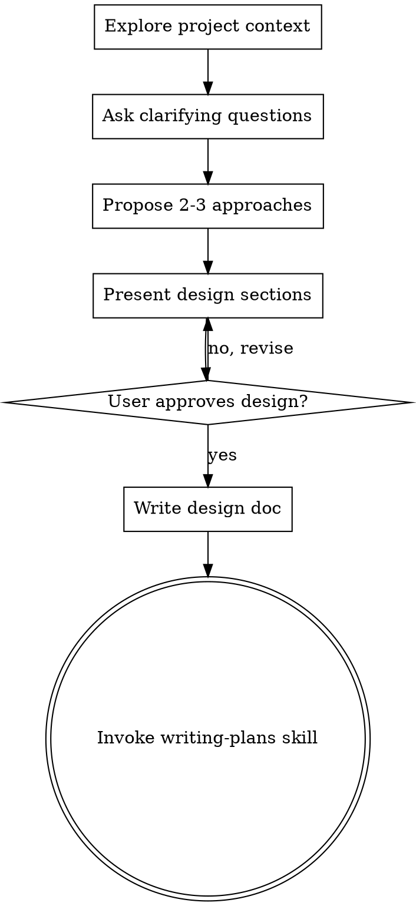
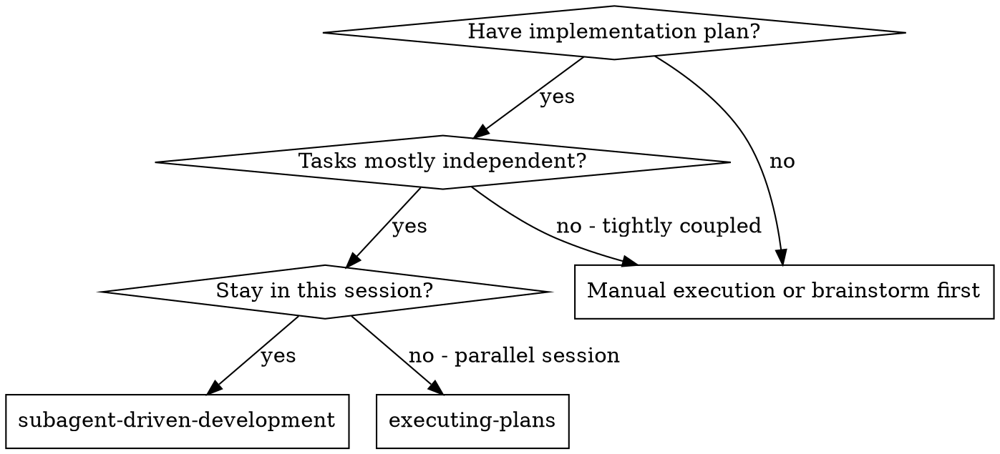
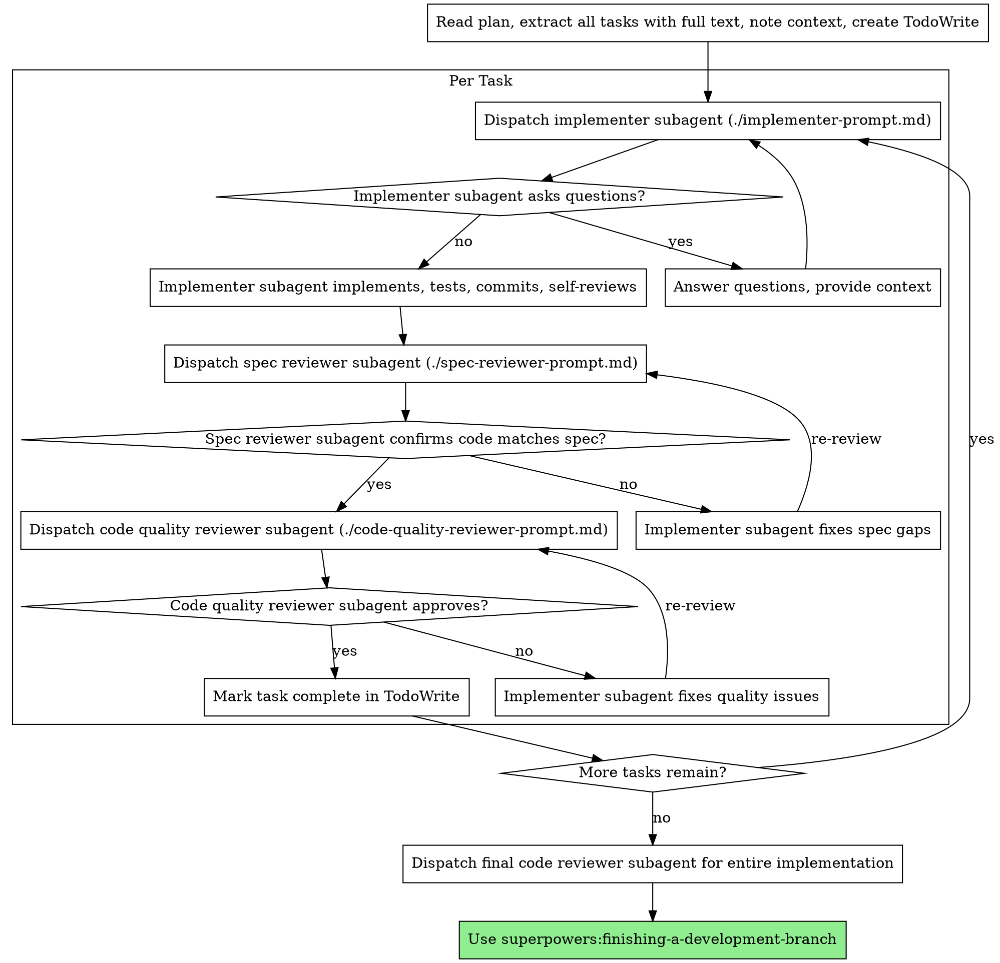

## Context Transfer from Claude Session

**IMPORTANT**: This is a context handoff from a Claude session.
The previous AI assistant completed the work described below.
Please review and continue from where it left off.

**Source Provider**: Claude
**Source Session**: c0ef68c7-f6b3-4429-b219-d018935f6ee8
**Transferred**: 2026-03-10 06:03:07
**Conversations**: 15

---

### Session Activity Summary

**Tool Calls:**
- TaskCreate: 26
- Bash: 22
- Read: 17
- Edit: 11
- TaskUpdate: 7
- Skill: 4
- Write: 3
- Glob: 3
- TaskList: 1

**Files Created/Written:**
- `/Users/myk/Desktop/111/docs/plans/2026-03-10-macmonitor-design.md`
- `docs/plans/2026-03-10-macmonitor-design.md`
- `docs/plans/2026-03-10-macmonitor-implementation-plan.md`
- `/Users/myk/Desktop/111/docs/plans/2026-03-10-macmonitor-implementation-plan.md`
- `backend/main.go`
- `backend/config/config.go`
- `backend/models/stats.go`
- `backend/collectors/collector.go`
- `backend/collectors/process.go`
- `backend/collectors/app.go`
- `/Users/myk/Desktop/111/docs/PROGRESS.md`
- `docs/PROGRESS.md`

**Files Read:**
- `/Users/myk/Desktop/111/backend/go.mod`
- `/Users/myk/Desktop/111/backend/main.go`
- `/Users/myk/Desktop/111/backend/config/config.go`
- `/Users/myk/Desktop/111/backend/models/stats.go`
- `/Users/myk/Desktop/111/backend/collectors/collector.go`
- `/Users/myk/Desktop/111/backend/collectors/disk.go`
- `/Users/myk/Desktop/111/backend/collectors/cpu.go`
- `/Users/myk/Desktop/111/backend/collectors/process.go`
- `/Users/myk/Desktop/111/backend/collectors/app.go`

**Tasks:** 3/26 completed

**Recent Tool Executions:**

- **Edit**
  - Input: /Users/myk/Desktop/111/backend/collectors/process.go
  - Result: `The file /Users/myk/Desktop/111/backend/collectors/process.go has been updated successfully.`
- **Edit**
  - Input: /Users/myk/Desktop/111/backend/collectors/app.go
  - Result: `The file /Users/myk/Desktop/111/backend/collectors/app.go has been updated successfully.`
- **Bash**
  - Input: /Users/myk/.local/bin/ask codex "请验证 /Users/myk/Desktop/111/backend/collectors/p...
  - Result: `[WARN] CCB_CALLER not set; using 'manual'. Set CCB_CALLER explicitly to override. I’ll re-check `process.go` and `app.go` for those two exact fixes an...`
- **TaskUpdate**
  - Input: #3 -> completed
  - Result: `Updated task #3 status`
- **TaskUpdate**
  - Input: #4 -> in_progress
  - Result: `Updated task #4 status`
- ... and 89 more

---

### Previous Conversation Context

#### Turn 1
**User**: 确认ccb联通正常

**Assistant**: [Tools: Skill x1]

---

#### Turn 2
**User**: Base directory for this skill: /Users/myk/.claude/skills/cping

# Ping AI Provider

Test connectivity with specified AI provider.

## Usage

The first argument must be the provider name:
- `gemini` - Test Gemini
- `codex` - Test Codex
- `opencode` - Test OpenCode
- `droid` - Test Droid
- `claude` - Test Claude

## Execution (MANDATORY)

Use `ccb-ping` wrapper to avoid conflict with system `ping`:
```
Bash(ccb-ping $PROVIDER)
```

## Examples

- `/cping gemini`
- `/cping codex`
- `/cping claude`

**Assistant**: [Tools: Bash 1 command(s)]

---

#### Turn 3
**User**: /Users/myk/Desktop/111，在这个项目下，我想要一个手机监控macmini各种情况活动监视器的app，有多种皮肤赛博可爱大海动漫人物等等

**Assistant**: [Tools: Skill x1]

---

#### Turn 4
**User**: Base directory for this skill: /Users/myk/.claude/plugins/cache/claude-plugins-official/superpowers/4.3.1/skills/brainstorming

# Brainstorming Ideas Into Designs

## Overview

Help turn ideas into fully formed designs and specs through natural collaborative dialogue.

Start by understanding the current project context, then ask questions one at a time to refine the idea. Once you understand what you're building, present the design and get user approval.

<HARD-GATE>
Do NOT invoke any implementation skill, write any code, scaffold any project, or take any implementation action until you have presented a design and the user has approved it. This applies to EVERY project regardless of perceived simplicity.
</HARD-GATE>

## Anti-Pattern: "This Is Too Simple To Need A Design"

Every project goes through this process. A todo list, a single-function utility, a config change — all of them. "Simple" projects are where unexamined assumptions cause the most wasted work. The design can be short (a few sentences for truly simple projects), but you MUST present it and get approval.

## Checklist

You MUST create a task for each of these items and complete them in order:

1. **Explore project context** — check files, docs, recent commits
2. **Ask clarifying questions** — one at a time, understand purpose/constraints/success criteria
3. **Propose 2-3 approaches** — with trade-offs and your recommendation
4. **Present design** — in sections scaled to their complexity, get user approval after each section
5. **Write design doc** — save to `docs/plans/YYYY-MM-DD-<topic>-design.md` and commit
6. **Transition to implementation** — invoke writing-plans skill to create implementation plan

## Process Flow



**The terminal state is invoking writing-plans.** Do NOT invoke frontend-design, mcp-builder, or any other implementation skill. The ONLY skill you invoke after brainstorming is writing-plans.

## The Process

**Understanding the idea:**
- Check out the current project state first (files, docs, recent commits)
- Ask questions one at a time to refine the idea
- Prefer multiple choice questions when possible, but open-ended is fine too
- Only one question per message - if a topic needs more exploration, break it into multiple questions
- Focus on understanding: purpose, constraints, success criteria

**Exploring approaches:**
- Propose 2-3 different approaches with trade-offs
- Present options conversationally with your recommendation and reasoning
- Lead with your recommended option and explain why

**Presenting the design:**
- Once you believe you understand what you're building, present the design
- Scale each section to its complexity: a few sentences if straightforward, up to 200-300 words if nuanced
- Ask after each section whether it looks right so far
- Cover: architecture, components, data flow, error handling, testing
- Be ready to go back and clarify if something doesn't make sense

## After the Design

**Documentation:**
- Write the validated design to `docs/plans/YYYY-MM-DD-<topic>-design.md`
- Use elements-of-style:writing-clearly-and-concisely skill if available
- Commit the design document to git

**Implementation:**
- Invoke the writing-plans skill to create a detailed implementation plan
- Do NOT invoke any other skill. writing-plans is the next step.

## Key Principles

- **One question at a time** - Don't overwhelm with multiple questions
- **Multiple choice preferred** - Easier to answer than open-ended when possible
- **YAGNI ruthlessly** - Remove unnecessary features from all designs
- **Explore alternatives** - Always propose 2-3 approaches before settling
- **Incremental validation** - Present design, get approval before moving on
- **Be flexible** - Go back and clarify when something doesn't make sense

**Assistant**: 我来探索一下当前项目环境，然后开始头脑风暴。

---

#### Turn 5
**User**: 12345

**Assistant**: 明白了！你想要一个功能比较全面的监控应用。

---

**第二个问题：**

关于皮肤/主题，你提到了赛博、可爱、大海、动漫人物等风格。我需要了解更多：

1. **皮肤数量** - 你希望内置多少种主题皮肤？（比如 4-6 种？）
2. **切换方式** - 用户如何切换皮肤？（设置里选择 / 滑动切换 / 随机）
3. **特殊需求** - 
   - 赛博朋克：霓虹色、故障风、数据流效果
   - 可爱：粉色系、卡通角色、圆润UI
   - 大海：蓝色系、波浪动画、海洋生物
   - 动漫人物：你希望是什么类型的角色？（猫娘、赛博少女、其他？）

请告诉我你的想法，特别是第3点，动漫人物皮肤你想要什么具体风格？

---

#### Turn 6
**User**: 5套皮肤，设置切换，赛博少女

**Assistant**: 很好！5套皮肤 + 设置切换 + 赛博少女风格。

---

**第三个问题：**

第5套皮肤你想要什么风格？选项：

1. **极简白色** - 苹果风格，白底黑字，干练简洁
2. **暗黑模式** - 深灰/黑色系，护眼
3. **蒸汽朋克** - 铜管、齿轮、机械风
4. **田园风格** - 绿色系，自然清新
5. **未来科技** - 蓝色全息、星空、科技感

请选择一个，或者告诉我你想要的另一个风格。

---

#### Turn 7
**User**: 4

**Assistant**: 好的！5套皮肤确定：

1. **赛博朋克** - 霓虹色、故障风、数据流效果
2. **可爱** - 粉色系、卡通角色、圆润UI
3. **大海** - 蓝色系、波浪动画、海洋生物
4. **赛博少女** - 动漫人物风格
5. **田园风格** - 绿色系，自然清新

---

**第四个问题：**

关于技术实现，你想要：

1. **原生iOS (Swift/SwiftUI)** - 性能好，体验佳
2. **跨平台 (Flutter)** - 一套代码同时支持iOS/Android
3. **React Native** - JS/TS开发，生态丰富

推荐SwiftUI，性能和体验最好。你觉得OK吗？

---

#### Turn 8
**User**: 1

**Assistant**: 好的！原生 iOS SwiftUI 开发。

---

**第五个问题：**

手机和Mac Mini之间如何传输数据？你有几个选择：

1. **局域网API** - Mac上运行一个轻量服务，手机通过WiFi访问（免费、自己部署）
2. **云服务中转** - 数据先上传到云，手机从云端拉取（需要服务器/数据库）
3. **本地网络发现** - 使用mDNS/Bonjour自动发现局域网设备

推荐方案1，Mac上运行一个小的HTTP服务，手机通过局域网IP访问，简单免费。

你觉得哪个方案更适合你？

---

#### Turn 9
**User**: 1

**Assistant**: 好的！局域网API方案。

---

**设计思路总结：**

我理解你想要的是：

| 模块 | 设计 |
|------|------|
| **功能** | CPU、内存、磁盘、网络、进程、应用使用 |
| **皮肤** | 5套（赛博朋克、可爱、大海、赛博少女、田园） |
| **切换** | 设置页面选择 |
| **技术** | 原生 iOS SwiftUI |
| **通信** | Mac运行HTTP服务，手机WiFi访问 |

---

**第六个问题（最后）：**

数据刷新频率你希望：

1. **实时 (1-2秒)** - 流畅但耗电
2. **普通 (5秒)** - 平衡，推荐
3. **省电模式 (10-30秒)** - 适合后台

推荐5秒普通模式，兼顾体验和续航。可以吗？

---

#### Turn 10
**User**: 2秒

**Assistant**: 好的！2秒实时刷新。

---

## 📋 设计方案

### 整体架构

```
┌─────────────┐      WiFi/HTTP       ┌─────────────┐
│   iPhone    │  ◄──────────────►   │  Mac Mini   │
│  (SwiftUI)  │    局域网API        │ (HTTP服务)  │
└─────────────┘                     └─────────────┘
```

**数据流**：Mac Mini运行HTTP服务 → 每2秒采集系统数据 → iPhone请求JSON → 展示

---

### 1. 功能模块

| 模块 | 监控内容 | 展示方式 |
|------|----------|----------|
| **仪表盘** | 总体概览：CPU、内存、磁盘、网络 | 卡片式布局 |
| **CPU** | 使用率、核心数、每个核心负载 | 图表 + 进度条 |
| **内存** | 已用/可用、Swap使用 | 环形进度条 |
| **磁盘** | 各分区容量、读写速度 | 饼图 |
| **网络** | 上传/下载速度、连接列表 | 实时曲线图 |
| **进程** | Top进程排行、CPU/内存占用 | 列表 |
| **应用** | 运行中的应用、活跃时间 | 卡片 |

---

### 2. 皮肤系统（5套）

| 皮肤 | 主色调 | 元素 | 字体 |
|------|--------|------|------|
| **赛博朋克** | 霓虹粉+青 | 故障特效、发光边框、数据流背景 | 等宽科技字体 |
| **可爱** | 粉色+白 | 圆润角、卡通图标、泡泡动画 | 圆体 |
| **大海** | 蓝色+白 | 波浪动画、鱼群气泡 | 清晰无衬线 |
| **赛博少女** | 紫色+霓虹 | 动漫少女助手、动态立绘 | 二次元风格 |
| **田园** | 绿色+米白 | 叶子纹理、自然元素 | 手写风格 |

---

### 3. 核心界面

**首页（仪表盘）**
- 顶部：4个核心指标卡片（CPU/内存/磁盘/网络）
- 中部：网络实时曲线图
- 底部：快速进程/应用入口
- 右上角：设置入口

**设置页面**
- 皮肤选择器（5个预览图）
- 刷新频率
- Mac Mini IP地址配置
- 主题预览

---

### 4. Mac端服务

一个简单的Go/Python HTTP服务，提供 `/api/stats` 接口返回JSON：

```json
{
  "cpu": {"usage": 45.2, "cores": 8},
  "memory": {"used": 16, "total": 32, "percent": 50},
  "disk": [{"name": "Macintosh HD", "used": 200, "total": 500}],
  "network": {"upload": 1024, "download": 2048},
  "processes": [{"name": "Safari", "cpu": 12, "mem": 5}],
  "apps": [{"name": "Xcode", "active": true}]
}
```

---

### 5. 项目结构

```
MacMonitor/
├── App/
│   ├── MacMonitorApp.swift
│   └── ContentView.swift
├── Views/
│   ├── Dashboard/
│   ├── CPUView/
│   ├── MemoryView/
│   ├── DiskView/
│   ├── NetworkView/
│   ├── ProcessView/
│   └── AppsView/
├── Themes/
│   ├── ThemeManager.swift
│   ├── CyberpunkTheme.swift
│   ├── CuteTheme.swift
│   ├── OceanTheme.swift
│   ├── CyberGirlTheme.swift
│   └── NatureTheme.swift
├── Services/
│   ├── MacDataService.swift
│   └── ThemeProvider.swift
└── Models/
    ├── SystemStats.swift
    └── Process.swift
```

---

这个设计方案看起来可以吗？确认后我写入设计文档并进入实现阶段。

---

#### Turn 11
**User**: 可以，要好看好用

**Assistant**: 好的！确保好看又好用。现在我来写设计文档。

---

#### Turn 12
**User**: Base directory for this skill: /Users/myk/.claude/plugins/cache/claude-plugins-official/superpowers/4.3.1/skills/writing-plans

# Writing Plans

## Overview

Write comprehensive implementation plans assuming the engineer has zero context for our codebase and questionable taste. Document everything they need to know: which files to touch for each task, code, testing, docs they might need to check, how to test it. Give them the whole plan as bite-sized tasks. DRY. YAGNI. TDD. Frequent commits.

Assume they are a skilled developer, but know almost nothing about our toolset or problem domain. Assume they don't know good test design very well.

**Announce at start:** "I'm using the writing-plans skill to create the implementation plan."

**Context:** This should be run in a dedicated worktree (created by brainstorming skill).

**Save plans to:** `docs/plans/YYYY-MM-DD-<feature-name>.md`

## Bite-Sized Task Granularity

**Each step is one action (2-5 minutes):**
- "Write the failing test" - step
- "Run it to make sure it fails" - step
- "Implement the minimal code to make the test pass" - step
- "Run the tests and make sure they pass" - step
- "Commit" - step

## Plan Document Header

**Every plan MUST start with this header:**

```markdown
# [Feature Name] Implementation Plan

> **For Claude:** REQUIRED SUB-SKILL: Use superpowers:executing-plans to implement this plan task-by-task.

**Goal:** [One sentence describing what this builds]

**Architecture:** [2-3 sentences about approach]

**Tech Stack:** [Key technologies/libraries]

---
```

## Task Structure

````markdown
### Task N: [Component Name]

**Files:**
- Create: `exact/path/to/file.py`
- Modify: `exact/path/to/existing.py:123-145`
- Test: `tests/exact/path/to/test.py`

**Step 1: Write the failing test**

```python
def test_specific_behavior():
    result = function(input)
    assert result == expected
```

**Step 2: Run test to verify it fails**

Run: `pytest tests/path/test.py::test_name -v`
Expected: FAIL with "function not defined"

**Step 3: Write minimal implementation**

```python
def function(input):
    return expected
```

**Step 4: Run test to verify it passes**

Run: `pytest tests/path/test.py::test_name -v`
Expected: PASS

**Step 5: Commit**

```bash
git add tests/path/test.py src/path/file.py
git commit -m "feat: add specific feature"
```
````

## Remember
- Exact file paths always
- Complete code in plan (not "add validation")
- Exact commands with expected output
- Reference relevant skills with @ syntax
- DRY, YAGNI, TDD, frequent commits

## Execution Handoff

After saving the plan, offer execution choice:

**"Plan complete and saved to `docs/plans/<filename>.md`. Two execution options:**

**1. Subagent-Driven (this session)** - I dispatch fresh subagent per task, review between tasks, fast iteration

**2. Parallel Session (separate)** - Open new session with executing-plans, batch execution with checkpoints

**Which approach?"**

**If Subagent-Driven chosen:**
- **REQUIRED SUB-SKILL:** Use superpowers:subagent-driven-development
- Stay in this session
- Fresh subagent per task + code review

**If Parallel Session chosen:**
- Guide them to open new session in worktree
- **REQUIRED SUB-SKILL:** New session uses superpowers:executing-plans

**Assistant**: 我正在使用 writing-plans skill 创建实现计划。

让我先检查当前环境，然后创建详细的实现计划。

---

#### Turn 13
**User**: 1

**Assistant**: [Tools: Skill x1]

---

#### Turn 14
**User**: Base directory for this skill: /Users/myk/.claude/plugins/cache/claude-plugins-official/superpowers/4.3.1/skills/subagent-driven-development

# Subagent-Driven Development

Execute plan by dispatching fresh subagent per task, with two-stage review after each: spec compliance review first, then code quality review.

**Core principle:** Fresh subagent per task + two-stage review (spec then quality) = high quality, fast iteration

## When to Use



**vs. Executing Plans (parallel session):**
- Same session (no context switch)
- Fresh subagent per task (no context pollution)
- Two-stage review after each task: spec compliance first, then code quality
- Faster iteration (no human-in-loop between tasks)

## The Process



## Prompt Templates

- `./implementer-prompt.md` - Dispatch implementer subagent
- `./spec-reviewer-prompt.md` - Dispatch spec compliance reviewer subagent
- `./code-quality-reviewer-prompt.md` - Dispatch code quality reviewer subagent

## Example Workflow

```
You: I'm using Subagent-Driven Development to execute this plan.

[Read plan file once: docs/plans/feature-plan.md]
[Extract all 5 tasks with full text and context]
[Create TodoWrite with all tasks]

Task 1: Hook installation script

[Get Task 1 text and context (already extracted)]
[Dispatch implementation subagent with full task text + context]

Implementer: "Before I begin - should the hook be installed at user or system level?"

You: "User level (~/.config/superpowers/hooks/)"

Implementer: "Got it. Implementing now..."
[Later] Implementer:
  - Implemented install-hook command
  - Added tests, 5/5 passing
  - Self-review: Found I missed --force flag, added it
  - Committed

[Dispatch spec compliance reviewer]
Spec reviewer: ✅ Spec compliant - all requirements met, nothing extra

[Get git SHAs, dispatch code quality reviewer]
Code reviewer: Strengths: Good test coverage, clean. Issues: None. Approved.

[Mark Task 1 complete]

Task 2: Recovery modes

[Get Task 2 text and context (already extracted)]
[Dispatch implementation subagent with full task text + context]

Implementer: [No questions, proceeds]
Implementer:
  - Added verify/repair modes
  - 8/8 tests passing
  - Self-review: All good
  - Committed

[Dispatch spec compliance reviewer]
Spec reviewer: ❌ Issues:
  - Missing: Progress reporting (spec says "report every 100 items")
  - Extra: Added --json flag (not requested)

[Implementer fixes issues]
Implementer: Removed --json flag, added progress reporting

[Spec reviewer reviews again]
Spec reviewer: ✅ Spec compliant now

[Dispatch code quality reviewer]
Code reviewer: Strengths: Solid. Issues (Important): Magic number (100)

[Implementer fixes]
Implementer: Extracted PROGRESS_INTERVAL constant

[Code reviewer reviews again]
Code reviewer: ✅ Approved

[Mark Task 2 complete]

...

[After all tasks]
[Dispatch final code-reviewer]
Final reviewer: All requirements met, ready to merge

Done!
```

## Advantages

**vs. Manual execution:**
- Subagents follow TDD naturally
- Fresh context per task (no confusion)
- Parallel-safe (subagents don't interfere)
- Subagent can ask questions (before AND during work)

**vs. Executing Plans:**
- Same session (no handoff)
- Continuous progress (no waiting)
- Review checkpoints automatic

**Efficiency gains:**
- No file reading overhead (controller provides full text)
- Controller curates exactly what context is needed
- Subagent gets complete information upfront
- Questions surfaced before work begins (not after)

**Quality gates:**
- Self-review catches issues before handoff
- Two-stage review: spec compliance, then code quality
- Review loops ensure fixes actually work
- Spec compliance prevents over/under-building
- Code quality ensures implementation is well-built

**Cost:**
- More subagent invocations (implementer + 2 reviewers per task)
- Controller does more prep work (extracting all tasks upfront)
- Review loops add iterations
- But catches issues early (cheaper than debugging later)

## Red Flags

**Never:**
- Start implementation on main/master branch without explicit user consent
- Skip reviews (spec compliance OR code quality)
- Proceed with unfixed issues
- Dispatch multiple implementation subagents in parallel (conflicts)
- Make subagent read plan file (provide full text instead)
- Skip scene-setting context (subagent needs to understand where task fits)
- Ignore subagent questions (answer before letting them proceed)
- Accept "close enough" on spec compliance (spec reviewer found issues = not done)
- Skip review loops (reviewer found issues = implementer fixes = review again)
- Let implementer self-review replace actual review (both are needed)
- **Start code quality review before spec compliance is ✅** (wrong order)
- Move to next task while either review has open issues

**If subagent asks questions:**
- Answer clearly and completely
- Provide additional context if needed
- Don't rush them into implementation

**If reviewer finds issues:**
- Implementer (same subagent) fixes them
- Reviewer reviews again
- Repeat until approved
- Don't skip the re-review

**If subagent fails task:**
- Dispatch fix subagent with specific instructions
- Don't try to fix manually (context pollution)

## Integration

**Required workflow skills:**
- **superpowers:using-git-worktrees** - REQUIRED: Set up isolated workspace before starting
- **superpowers:writing-plans** - Creates the plan this skill executes
- **superpowers:requesting-code-review** - Code review template for reviewer subagents
- **superpowers:finishing-a-development-branch** - Complete development after all tasks

**Subagents should use:**
- **superpowers:test-driven-development** - Subagents follow TDD for each task

**Alternative workflow:**
- **superpowers:executing-plans** - Use for parallel session instead of same-session execution

**Assistant**: 我正在使用 Subagent-Driven Development 来执行实现计划。

根据 skill 要求，需要先设置隔离工作空间。但检查发现当前目录，我将继续不是 git 仓库在当前目录执行。

---

#### Turn 15
**User**: 保存当前进度，我要开启新的窗口

**Assistant**: 好的，让我保存当前进度。

---

**Action Required**: Review the above context and continue the work.